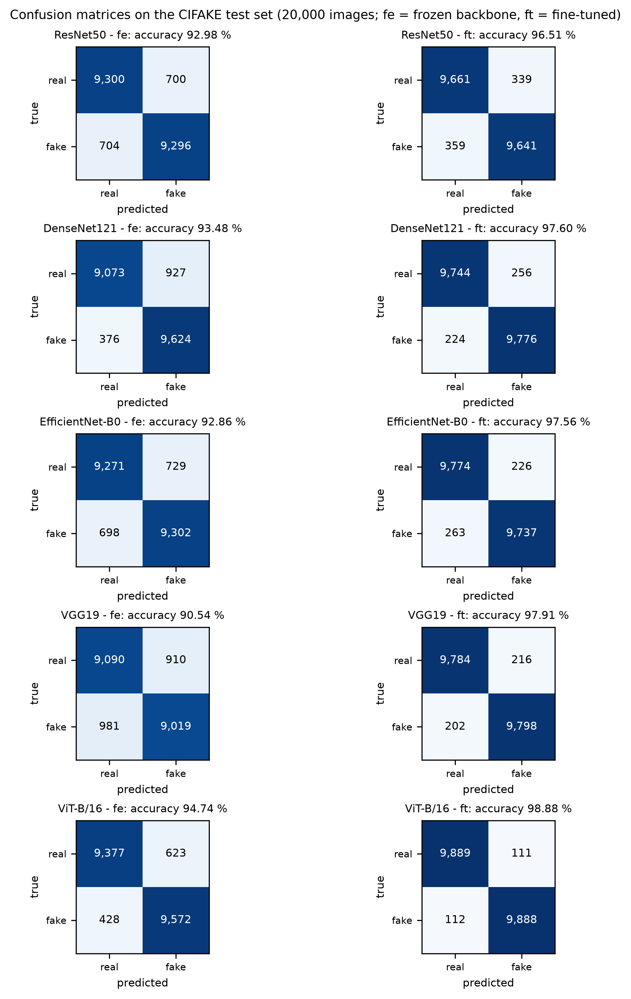
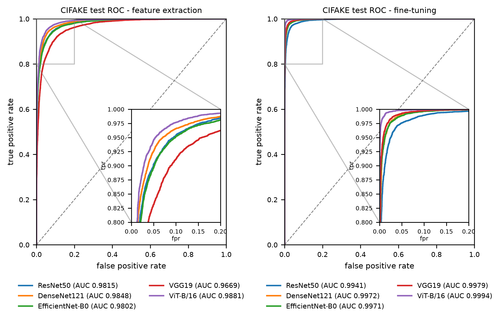
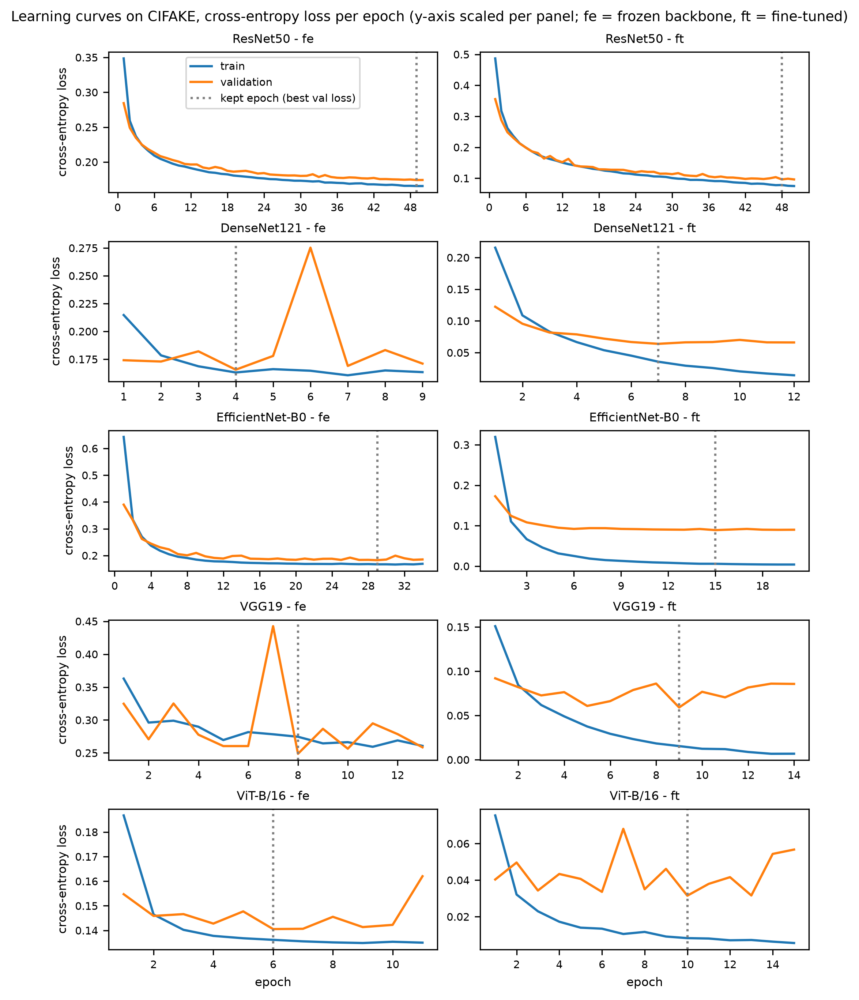
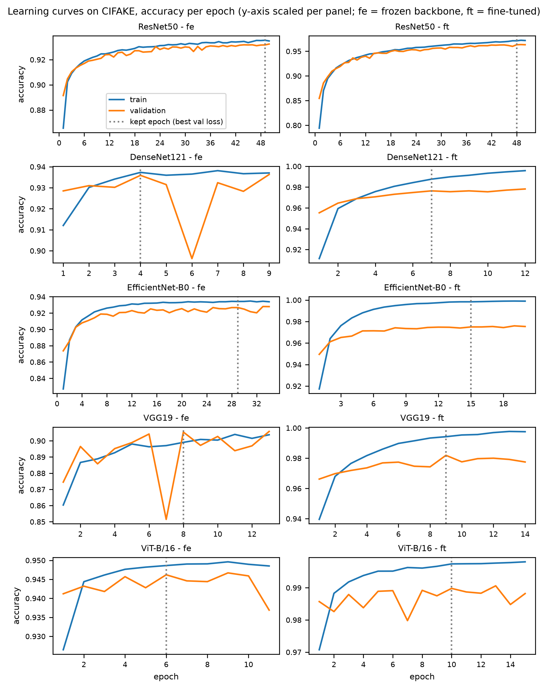
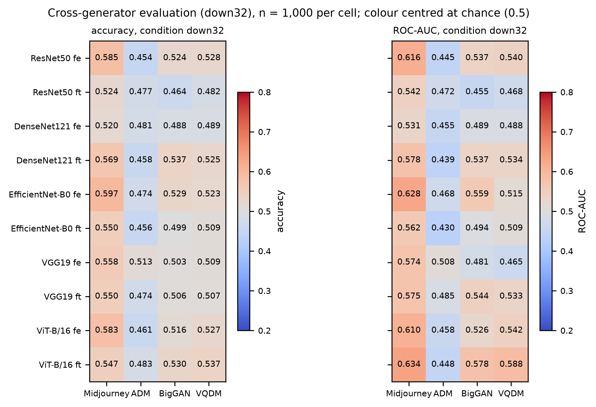
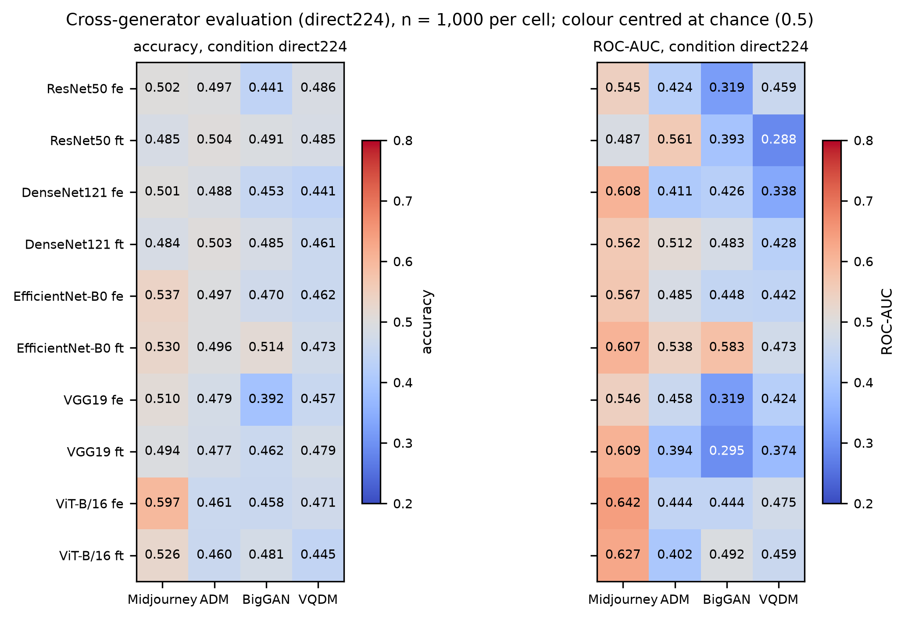
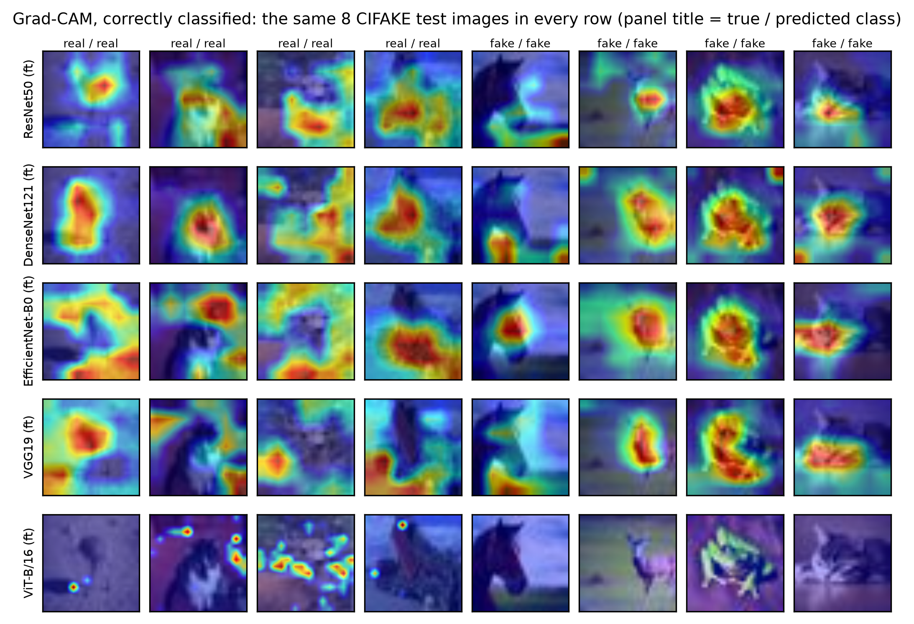
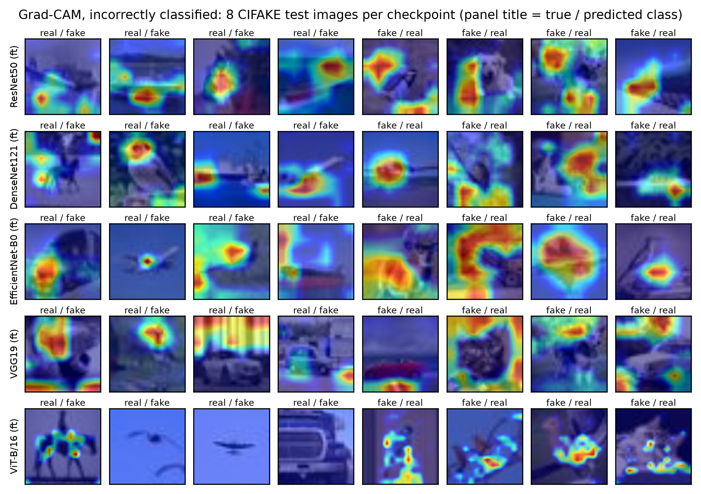

<!-- Generated by paper2/build_paper.py from paper2/sections/*.md, results/tables/*.md, figures/*.png and sem7_minor/references/references.bib. Do not edit this file; edit the sections and rebuild. -->

# Front matter

**Working title:** Transfer Learning for AI-Generated Image Detection: A Matched Comparison of Four CNN Backbones and a Vision Transformer on CIFAKE, with Grad-CAM and Cross-Generator Evaluation

Rohit Yadav, Vishal, Hardik Mehlawat — Amity School of Engineering and Technology, Amity University Uttar Pradesh. Guide: Dr. Richa Gupta.

*[Working title. Author order, the guide's designation and the shape of the merged publication are open items 4, 11 and 19 in CLAUDE.md and are decided at the P2 gate, not here.]*

## Abstract

Detectors of AI-generated images are usually reported one architecture at a time, on one dataset, rarely with an explanation analysis and a test on unseen generators. This paper compares four ImageNet-pretrained convolutional neural network (CNN) backbones (ResNet50, DenseNet121, EfficientNet-B0, VGG19) and a Vision Transformer (ViT-B/16) under one protocol on CIFAKE (120,000 images: CIFAR-10 photographs and Stable Diffusion v1.4 images at 32×32 pixels). Each backbone is trained frozen (feature extraction) and with every parameter updated (fine-tuning), under one seed, a committed split and logged library versions; every reported number is generated from the run logs by script. On the 20,000-image test set, fine-tuning improves every backbone by 3.5 to 7.4 percentage points and changes the ordering: VGG19 is the weakest frozen backbone (90.54%) and the strongest fine-tuned CNN (97.91%). ViT-B/16 leads under both configurations (94.74% and 98.88%), while fine-tuned DenseNet121 and EfficientNet-B0 (97.60% and 97.56%) cannot be separated on one seed. On eight shared test images, Grad-CAM puts the fine-tuned CNNs' highest activations mostly on the subject; on the ViT the method as applied returned an all-zero map on half of them. On 1,000-image subsets of four unseen GenImage generators (Midjourney, ADM, BigGAN, VQDM), every checkpoint falls to chance: per-checkpoint mean accuracy 0.46 to 0.53, and an area under the receiver operating characteristic curve (AUC) below 0.5 in 43 of 80 cells. Content shift, downsampling and a PNG/JPEG asymmetry between the classes prevent attributing the collapse to the generators alone; it is reported as a bracketed negative result.

**Keywords:** AI-generated image detection; transfer learning; convolutional neural networks; vision transformer; Grad-CAM; cross-generator generalisation; CIFAKE

# 1. Introduction

Text-to-image diffusion models have made photograph-like synthetic images cheap to produce [C69], and enough of them are posted on public platforms for whole datasets to have been built from what users share [C56]. Deciding whether a picture came from a camera or from a generator is therefore a practical requirement for journalism, for the handling of visual evidence and for the curation of web-scraped training corpora, and at the scale of a social platform it can only be done automatically. The companion review written in the first phase of this project (Semester 7) surveyed 48 primary studies on this problem; this paper reports the experimental second phase.

The review's central finding was that generalisation across generators is the open problem of the field. Detectors tend to be accurate on the generator family they were trained on and to lose much of that accuracy on other families: a ResNet-50 trained on ProGAN images reached 90.8 mean average precision (mAP) averaged over eleven test sets from generators unseen in training [C01], but detectors trained on generative adversarial network (GAN) output lose 15.2% AUROC on average — area under the receiver operating characteristic curve, written AUC elsewhere in this paper — when the test images come from diffusion models [C23], and even within the diffusion family a ResNet-50 at 99.9% accuracy on its training generator scored 54.9% on Midjourney [C52]. The AIDE detector proposed alongside the Chameleon benchmark averages 92.77% on a standard benchmark but 65.77% on the realistic images Chameleon collects [C36]. The usual explanation is that the cues a detector picks up are tied to the design of the generator it was trained on, so a generator built differently need not leave them.

The review also found a gap in how the evidence is produced. Cross-generator evaluation was reported by 36 of the 48 studies and an explanation analysis by four, almost never together; comparisons between convolutional and transformer backbones usually change the pretraining data and the training objective at the same time as the architecture, so that only one surveyed study isolated the architecture itself [C44]; and the ImageNet-pretrained convolutional neural network (CNN) backbones that transfer-learning detectors are built on [C72, C73, C74, C75] are rarely compared with each other under one protocol. None of the 48 studies brought all of this together, that is (i) more than one pretrained CNN backbone under a single protocol, (ii) a Vision Transformer [C70] trained under that same protocol, (iii) an explanation analysis of the trained models, and (iv) an evaluation on generators absent from training.

This paper addresses that combination on a deliberately small scale. Five backbones — ResNet50, DenseNet121, EfficientNet-B0, VGG19 and ViT-B/16 — are each trained on CIFAKE [C51] in two transfer-learning configurations, feature extraction and fine-tuning, giving a ten-run matrix under one data split, one seed and one set of logged hyperparameters. Grad-CAM [C61] is applied to correctly and incorrectly classified test images of every backbone's better checkpoint, and all ten checkpoints are evaluated, without any further training, on four generators from GenImage [C52] that none of them has seen. The study is intended as a controlled measurement rather than a new detector: no architecture, loss or input transformation is proposed.

The study asks four questions: (RQ1) how much fine-tuning adds over a linear probe for each backbone; (RQ2) whether ViT-B/16 differs from the four CNNs when data, split, seed, augmentation and stopping rule are matched; (RQ3) where the fine-tuned models take their evidence from, as far as Grad-CAM can show; and (RQ4) whether any of the ten checkpoints transfers to generators unseen in training.

The contributions are:

1. A matched comparison of four CNN backbones and a ViT benchmark under feature extraction and fine-tuning on CIFAKE, with per-run convergence, parameter counts and training cost reported alongside accuracy, precision, recall, F1, AUC and average precision.
2. An explanation analysis with Grad-CAM over a shared set of test images for all five backbones, so that the maps compare like with like.
3. A cross-generator evaluation of all ten checkpoints on four unseen generators under two preprocessing conditions, with the confounds that limit its interpretation stated in advance.
4. A reproducibility protocol in which the data split is a committed file, every run logs its seed, hardware and library versions to a CSV, and every table and figure in this paper is generated from those files by script rather than typed by hand.

The remainder of the paper is organised as follows. Section 2 places the work in the literature. Section 3 describes the datasets, the split, the backbones, the training setup, the metrics, the cross-generator and explanation protocols and the computing environment. Section 4 reports the results, Section 5 discusses them together with the study's limitations, and Section 6 concludes.

# 2. Related Work

This section summarises the parts of the companion review that bear directly on the experiment; the review covers the field in full.

## 2.1 Transfer-learning detectors built on CNN backbones

The standard recipe takes an ImageNet-pretrained backbone and trains it, or a classification head on top of it, on labelled real and generated images. The reference result for this recipe is from Wang et al.: an ImageNet-pretrained ResNet-50 that saw only ProGAN images in training, with blur and JPEG augmentation applied, averaged 90.8 mAP across eleven test sets drawn from generators absent from training [C01]. Two follow-ups matter here. Running seven detectors, among them that ResNet-50, through one benchmark, Gragnaniello et al. obtained AUC above 0.9 on unseen GAN images as long as those images were uncompressed, and large losses once the images were compressed and resized [C03]; Cozzolino et al. changed the training objective to a contrastive one and reported 95.6% accuracy across seven GAN architectures absent from training [C11]. When diffusion models arrived, much of that transfer was lost: Corvi et al. put GAN-trained detectors at roughly 60–76% accuracy on uncompressed diffusion images and roughly 50–61% once the images were compressed and resized [C24], and Ricker et al. quantified the same loss as an average fall of 15.2% in AUROC [C23]. The recent literature responds by moving away from the plain pretrained-CNN recipe — gradients or reconstruction residuals in place of pixels [C15, C25], frozen vision-language representations with a small probe on top [C37, C38], or training on thousands of generators [C35]. None of those is the subject of this paper, which measures the plain recipe itself: the companion review found it standard yet rarely compared like for like across backbones.

## 2.2 Convolutional versus transformer backbones

A Vision Transformer cuts the image into patches and relates them by self-attention from the first layer [C70]; a convolutional network builds its view of the image gradually through local filters. Which inductive bias suits detection is not settled by the published comparisons, because changing the backbone usually changes the pretraining data and the objective as well. The exception is Coccomini et al., whose ViT-Base and EfficientNetV2-M were trained on identical ForgeryNet subsets, so that the architecture was the only thing that changed [C44]. On manipulation methods present in training the CNN led, at 81.1%; on methods absent from training it dropped to 47.0–57.0%, whereas the ViT's accuracy was roughly 62.0% in each of the three cross-forgery settings [C44]. GenImage benchmarks a ResNet-50 beside DeiT-S and Swin-T under one protocol, on its own training distribution [C52]. The present study keeps the data, split, seed, augmentation and early-stopping rule identical across the five backbones (the epoch ceiling — 30, raised to 50 for the three runs that reached it — cannot change a run that stops on patience; Section 3.5); what it cannot hold fixed is the optimiser (stochastic gradient descent, SGD, for the CNNs and AdamW for the ViT), the batch size, and the pretraining corpus of the weights the timm library distributes, to which Section 5.2 returns.

## 2.3 Explanation in detection

Grad-CAM weights the activations of a chosen layer by the gradient of the class score and projects the result back onto the image as a coarse heat map [C61]; Grad-CAM++ refines the weighting [C62]. Both methods were built for object classifiers, whose decisive region is normally a visible object; the cues a detector relies on are often not visible in that sense, which limits what a heat map can show here. Bird and Lotfi applied Grad-CAM to the small custom CNN trained in the CIFAKE paper and reported that its decisions rested on small imperfections in image backgrounds rather than on the subject [C51]. Tsigos et al. showed that the quality of such explanations can be measured, by the accuracy drop caused by removing the segment an explanation ranks first, for one detector on FaceForensics++ [C63], and Aghasanli et al. built interpretability in through prototypes over fine-tuned ViT features [C64]. The review found explanation and cross-generator testing reported together in almost no study; this paper does both on the same checkpoints.

## 2.4 Datasets and their biases

CIFAKE pairs 60,000 CIFAR-10 photographs with 60,000 images generated by Stable Diffusion v1.4 at 32×32 pixels, released by its authors as 100,000 training and 20,000 test images [C51]. Its small images make a five-architecture comparison tractable on free hardware, but it contains one generator, so it cannot show a cross-generator drop by itself. GenImage supplies the complement: more than a million images from eight generators paired with ImageNet photographs, with cross-generator classification defined as a benchmark task [C52]. Two warnings from the review apply to both. Grommelt et al. showed that in GenImage the JPEG compression level and the image size are themselves correlated with the label, so a classifier can reach a high score by reading those two properties rather than any forensic trace; training with both differences removed raised a ResNet50's cross-generator accuracy from 71.68% to 82.74% [C31]. And Yan et al. showed that benchmark accuracy overstates in-the-wild accuracy by a wide margin, 92.77% against 65.77% [C36]. Section 3.1 records the format asymmetry found in the GenImage subset used here (Table 1) and Section 3.7 treats it as a stated confound rather than something the study could correct.

## 2.5 Position of this study

Against this background the study is a controlled baseline: the plain transfer-learning recipe, five common backbones, one protocol, an explanation pass and a cross-generator pass on the same checkpoints, with the measurement choices documented in enough detail to be repeated. It does not propose a detector and does not claim state-of-the-art performance on any benchmark.

# 3. Materials and Methods

## 3.1 Datasets

**CIFAKE.** CIFAKE [C51] is the training dataset and the primary test dataset. It holds 120,000 colour images of 32×32 pixels in two classes: 60,000 photographs taken from CIFAR-10 and 60,000 images generated with Stable Diffusion v1.4 to match the ten CIFAR-10 categories. Its authors release it as 100,000 training images (50,000 per class) and 20,000 test images (10,000 per class). The release was used as published; no image was removed or re-encoded.

**GenImage subset.** For the cross-generator test, images from four GenImage [C52] generators that none of the trained models has seen were taken from the Kaggle dataset `yangsangtai/tiny-genimage` (https://www.kaggle.com/datasets/yangsangtai/tiny-genimage; licence CC BY-NC-SA 4.0), a per-generator sample of GenImage that keeps the official folder convention of generated (`ai`) and real (`nature`) images. The four generators were fixed before any evaluation: Midjourney, ADM, BigGAN and VQDM — two diffusion models, one GAN and one proprietary text-to-image system. The Stable Diffusion folder was excluded because CIFAKE's generated images come from that family, and the other folders present (Wukong, GLIDE) were outside the four chosen. Only each generator's `val` split was used. Table 1 records what the dataset contained when it was read, because its composition departs from the plan in three ways that matter for interpretation: each `val` split holds 500 generated and 500 real images, so every evaluation cell has 1,000 images rather than the 2,000–3,000 planned; every generated file is a PNG and every real file a JPEG, for all generators; and, in the first 20 files of each class that were inspected, the generated images are square, at 128×128 (BigGAN), 256×256 (ADM, VQDM) or 1024×1024 (Midjourney) pixels, while the real images are ImageNet photographs of mixed sizes, most often 500×375 or 375×500; the sizes of the remaining files were not read. That the real images are GenImage's paired ImageNet set rests on the GenImage paper and the folder naming; it cannot be confirmed from the files.

<!-- table:start t5_tiny_genimage_composition -->
**Table 1.** Composition of the tiny-genimage `val` split as found at evaluation time, one row per generator folder: image counts per class, file formats (extension:count) and the most common pixel sizes among the first 20 files per class. The four generators used in the cross-generator sweep are marked; the Stable Diffusion v1.5, Wukong and GLIDE folders were present but not used.

| dir_name | generator | used_in_sweep | n_ai | n_nature | ai_ext | nature_ext | ai_size_first20 | nature_size_first20 |
|---|---|---|---|---|---|---|---|---|
| imagenet_ai_0419_biggan | biggan | yes | 500 | 500 | .png:500 | .jpeg:500 | 128x128:20 | 500x375:7 500x333:2 500x332:2 |
| imagenet_ai_0419_vqdm | vqdm | yes | 500 | 500 | .png:500 | .jpeg:500 | 256x256:20 | 500x375:7 375x500:3 500x376:1 |
| imagenet_ai_0424_sdv5 | - | no | 500 | 500 | .png:500 | .jpeg:500 | 512x512:20 | 500x375:5 500x334:1 473x500:1 |
| imagenet_ai_0424_wukong | - | no | 500 | 500 | .png:500 | .jpeg:500 | 512x512:20 | 500x375:6 500x334:2 1061x668:1 |
| imagenet_ai_0508_adm | adm | yes | 500 | 500 | .png:500 | .jpeg:500 | 256x256:20 | 500x375:7 375x500:2 500x376:1 |
| imagenet_glide | - | no | 500 | 500 | .png:500 | .jpeg:500 | 256x256:20 | 500x375:4 375x500:2 500x333:1 |
| imagenet_midjourney | midjourney | yes | 500 | 500 | .png:500 | .jpeg:500 | 1024x1024:20 | 500x375:6 375x500:3 500x361:2 |

Notes:
- Source: results/genimage_verification.csv, recorded by code/run_crossgen.py from the attached yangsangtai/tiny-genimage val split before the sweep; ai = generated, nature = real; *_ext = extension histogram; *_size_first20 = pixel sizes of the first 20 files.
- Generators used in the sweep: midjourney, adm, biggan, vqdm - four generators unseen in training (plan 3; Stable Diffusion folders are excluded because CIFAKE's fakes are SD v1.4). Folders present but not used: imagenet_ai_0424_sdv5, imagenet_ai_0424_wukong, imagenet_glide.
- Rounding: a value is the string logged in the CSV (runs.csv metrics carry six decimals, crossgen.csv the full float repr), rounded half-to-even on that decimal value - e.g. test_acc 0.928650 -> 92.86 %, 0.934850 -> 93.48 %, AUC 0.980733 -> 0.9807.
- Generated by code/make_tables.py from the files named above; nothing typed by hand.
<!-- table:end -->

## 3.2 Data split and preprocessing

The official CIFAKE test set is used only for final evaluation, once per trained model. From the 100,000 training images a validation set of 10,000 (5,000 per class) was drawn once with seed 42 by shuffling the sorted file list of each class, leaving 90,000 images (45,000 per class) for training. The assignment is stored as a committed CSV of relative file names, one line per image, so that the same images land in the same split on every machine; an index-based split was ruled out because directory enumeration order differs between Windows and Linux. Model selection and early stopping use the validation set only.

Every image passes through the same pipeline at training and test time: resizing to 224×224 pixels by bilinear interpolation (the input size the ImageNet-pretrained weights expect, so CIFAKE's 32×32 images are upscaled seven times), conversion to a tensor, and normalisation with the ImageNet channel means and standard deviations. The only augmentation in the baseline is a random horizontal flip with probability 0.5, applied to training images; stronger augmentation was left to the ablation phase so that the baseline recipe changes one factor at a time, and its effect on the low-level traces a detector relies on is not assumed either way. For the frozen-backbone configuration the backbone is kept in evaluation mode throughout, so that its batch-normalisation running statistics stay at their ImageNet values; turning off gradients alone would not stop them adapting.

## 3.3 Backbones

Five ImageNet-pretrained backbones were taken from the timm library through its single `create_model` call, each with its final classifier replaced by a freshly initialised linear layer with two outputs: ResNet50 [C72], DenseNet121 [C73], EfficientNet-B0 [C74], VGG19 [C75] and ViT-B/16 [C70], the base Vision Transformer with 16×16-pixel patches at 224-pixel input. Their total parameter counts as instantiated are 23.5, 7.0, 4.0, 139.6 and 85.8 million (Section 4.2). The new head takes the pooled feature of each network — 2048, 1024, 1280 and 768 values for ResNet50, DenseNet121, EfficientNet-B0 and the ViT — and, for VGG19, the 4,096-value output of its two fully connected layers, which timm keeps inside the backbone and which therefore stay frozen under feature extraction; so under feature extraction the trainable parameters are the weights and biases of that one new layer, from 1,538 for the ViT to 8,194 for VGG19. The weights are the default pretrained weights timm resolves for each model name, which on the development machine (timm 1.0.28) were `resnet50.a1_in1k`, `densenet121.ra_in1k`, `efficientnet_b0.ra_in1k`, `vgg19.tv_in1k` and `vit_base_patch16_224.augreg2_in21k_ft_in1k`: ImageNet-1k weights for the four CNNs, while the default ViT-B/16 weights were pre-trained on ImageNet-21k and then fine-tuned on ImageNet-1k. The weight tag was not logged per run, and the Kaggle runs used timm 1.0.26 `[VERIFY that the defaults match in 1.0.26]`. The difference in pretraining corpus is a confound for the CNN-versus-ViT comparison and is taken up in Section 5.2.

## 3.4 Transfer-learning configurations

Each backbone was trained in two configurations, which gives the ten-run matrix:

- **Feature extraction (fe).** Every backbone parameter is frozen; only the new two-class head is trained. The backbone acts as a fixed feature extractor and the head is a linear probe on its pooled output.
- **Fine-tuning (ft).** Every parameter is trainable, starting from the pretrained weights, with a smaller learning rate so that the pretrained features are adjusted rather than overwritten.

Feature extraction versus fine-tuning is therefore one of the factors of the study, not a separate ablation. Training from random initialisation, without pretrained weights, was not run.

## 3.5 Training setup

Every hyperparameter lives in a per-run configuration file that is copied into the run's artefact directory, and Table 2 reproduces the values with the one-line reason recorded beside each of them in those files. The CNNs were trained with stochastic gradient descent with momentum 0.9, at a learning rate of 0.01 when only the head trains and 0.001 when the whole network does; the ViT was trained with AdamW at 1×10⁻³ and 3×10⁻⁵ respectively, the usual optimiser for transformers and a rate small enough not to degrade the pretrained features. Each learning rate was held constant for the whole run; no schedule, warm-up or gradient clipping was used, and AdamW ran with PyTorch's default β values. The loss is the cross-entropy over the two logits, and the generated-class probability used for the threshold-free metrics is the softmax of the second logit. Weight decay was zero, with early stopping and the flip augmentation as the only guards against overfitting. Batch size was 128 for ResNet50, DenseNet121 and EfficientNet-B0 and 64 for VGG19 and the ViT, which need the smaller batch to fit a 15 GB GPU at 224 pixels; mixed precision was on throughout. Training ran for at most 30 epochs with early stopping after five epochs without improvement in validation loss, keeping the checkpoint with the lowest validation loss. Three runs — ResNet50 in both configurations and EfficientNet-B0 under feature extraction — reached the 30-epoch ceiling with their best epoch at or next to it; they were rerun with a ceiling of 50 epochs and nothing else changed, and the rerun rows are the ones reported in the main tables, with the originals kept for comparison in Section 4.2. The ten runs reported in the main tables — the three reruns and the seven runs that did not need one — are listed in a committed manifest file and are called the canonical runs below. No run was stopped by a session-time limit. One seed, 42, fixes the split, the head initialisation, the shuffling order and the augmentation; seed variance was not measured.

<!-- table:start t4_hyperparameters -->
**Table 2.** Training configuration of the canonical runs and the stated reason for each choice, read from the run configuration files. A setting listed more than once differs between runs; the configuration files carrying each value are named in brackets (the `_e50` suffix marks the three 50-epoch reruns). A dash means the key is absent from that configuration.

| setting | value | justification |
|---|---|---|
| resolution | 224 | ImageNet-pretrained weights expect 224x224 |
| batch_size | 128 (resnet50_fe_e50) | ResNet50 at 224 fits comfortably on a T4 at this size |
| batch_size | 128 (resnet50_ft_e50, densenet121_fe, densenet121_ft, efficientnet_b0_fe_e50, efficientnet_b0_ft) | fits a T4 for the lighter backbones |
| batch_size | 64 (vgg19_fe, vgg19_ft, vit_base_patch16_224_fe, vit_base_patch16_224_ft) | VGG19 and ViT need the smaller batch for T4 memory |
| augment | hflip | horizontal flip only; anything stronger is an ablation, not the baseline |
| optimizer | sgd (resnet50_fe_e50, resnet50_ft_e50, densenet121_fe, densenet121_ft, efficientnet_b0_fe_e50, efficientnet_b0_ft, vgg19_fe, vgg19_ft) | sgd with momentum for the CNNs, the conventional optimiser for transfer learning with ImageNet-pretrained CNNs; adamw for ViT, the conventional optimiser for transformers |
| optimizer | adamw (vit_base_patch16_224_fe, vit_base_patch16_224_ft) | sgd with momentum for the CNNs, the conventional optimiser for transfer learning with ImageNet-pretrained CNNs; adamw for ViT, the conventional optimiser for transformers |
| lr | 0.01 (resnet50_fe_e50) | higher lr is safe here: only the freshly initialised head is being trained |
| lr | 0.001 (resnet50_ft_e50, densenet121_ft, efficientnet_b0_ft, vgg19_ft) | pretrained weights need small updates or the features are destroyed |
| lr | 0.01 (densenet121_fe, efficientnet_b0_fe_e50, vgg19_fe) | only the fresh head trains, so a larger rate converges quickly |
| lr | 0.001 (vit_base_patch16_224_fe) | head only, higher rate is safe; AdamW is the standard ViT optimiser |
| lr | 0.00003 (vit_base_patch16_224_ft) | full ViT-B/16 updates need a small rate or pretrained features degrade |
| momentum | 0.9 (resnet50_fe_e50, resnet50_ft_e50, densenet121_fe, densenet121_ft, efficientnet_b0_fe_e50, efficientnet_b0_ft, vgg19_fe, vgg19_ft) | standard SGD momentum; ignored when optimizer is adamw |
| momentum | - (vit_base_patch16_224_fe, vit_base_patch16_224_ft) | standard SGD momentum; ignored when optimizer is adamw |
| weight_decay | 0.0 | no regularisation in the baseline; revisit only if learning curves show overfitting |
| max_epochs | 50 (resnet50_fe_e50, resnet50_ft_e50, efficientnet_b0_fe_e50) | a ceiling, not a target — early stopping normally ends the run sooner |
| max_epochs | 30 (densenet121_fe, densenet121_ft, efficientnet_b0_ft, vgg19_fe, vgg19_ft, vit_base_patch16_224_fe, vit_base_patch16_224_ft) | a ceiling, not a target — early stopping normally ends the run sooner |
| early_stopping_patience | 5 | stop after 5 epochs with no validation-loss improvement, to save GPU quota |
| amp | true | mixed precision: lower memory and shorter epochs on a T4; confirmed at A2 (GPU smoke bit-identical to CPU) |
| checkpoint | best_val_loss | keep the best-by-validation-loss checkpoint, discard the rest |
| seed | 42 | one seed for split, init, shuffling and augmentation |

Notes:
- Source: the config YAML of each canonical run (config_path in results/runs.csv), cross-checked field by field against the run's config_used.yaml, and configs/template.yaml; values are quoted as written in the file; the justification is the inline comment on that line, falling back to template.yaml's comment; one row per distinct (value, justification), with the config files carrying it in brackets when a setting has more than one row.
- A value shown as '-' means the key is absent in that config (momentum is unused by AdamW).
- Rounding: a value is the string logged in the CSV (runs.csv metrics carry six decimals, crossgen.csv the full float repr), rounded half-to-even on that decimal value - e.g. test_acc 0.928650 -> 92.86 %, 0.934850 -> 93.48 %, AUC 0.980733 -> 0.9807.
- Generated by code/make_tables.py from the files named above; nothing typed by hand.
<!-- table:end -->

## 3.6 Evaluation metrics

The generated image is the positive class, as in the companion review and most of the literature; the code, the tables and the figure labels call this class fake and the photographs real. With TP, FP, TN and FN the counts of true positives, false positives, true negatives and false negatives on a test set, and TPR and FPR the true and false positive rates:

`Accuracy = (TP + TN) / (TP + TN + FP + FN)`  (1)

`Precision = TP / (TP + FP)`  (2)

`Recall = TPR = TP / (TP + FN)`  (3)

`F1 = 2 · Precision · Recall / (Precision + Recall)`  (4)

`FPR = FP / (FP + TN)`  (5)

The threshold-dependent metrics (1)–(4) are computed at a decision threshold of 0.5 on the generated-class probability, which for a two-class softmax is the same as taking the larger logit. The receiver operating characteristic (ROC) curve plots TPR against FPR as the threshold sweeps from 1 to 0, and its area

`AUC = ∫₀¹ TPR(FPR) d(FPR)`  (6)

is 0.5 for a random scorer and 1 for perfect separation. Average precision summarises the precision–recall curve as

`AP = Σ_k (R_k − R_{k−1}) · P_k`  (7)

with P_k and R_k the precision and recall at the k-th threshold. Metrics (1)–(4), (6) and (7) are computed with scikit-learn (`accuracy_score`, `precision_score`, `recall_score` and `f1_score` with the generated class as the positive label, `roc_auc_score` and `average_precision_score`); FPR enters only as the abscissa of the ROC points written by `roc_curve`. The per-run confusion matrix, the ROC points and the per-epoch training and validation loss and accuracy are written to CSV files alongside them. On a balanced test set of 20,000 images, accuracy is a multiple of 0.005 percentage points, so ties at the second decimal are structural; Section 3.9 states the rounding rule.

## 3.7 Cross-generator protocol

Every one of the ten checkpoints was evaluated, without any further training or threshold adjustment, on each of the four GenImage generators (500 real and 500 generated images each) under two preprocessing conditions, giving 10 × 4 × 2 = 80 evaluation cells of 1,000 images. The two conditions bracket a confound that the mismatch in resolution creates:

- **down32 (primary).** Each GenImage image is first downsampled to 32×32 and then passed through the identical 32-to-224 pipeline used for CIFAKE, so that the detector sees inputs with the same resolution history it was trained on.
- **direct224 (sensitivity check).** Each image is resized straight to 224×224.

Neither condition isolates the generator, and three confounds are stated here, before the results. First, content shift: CIFAKE's real images are CIFAR-10 photographs of ten object categories and GenImage's are ImageNet photographs, so any drop mixes a change of content with a change of generator. Second, evidence destruction: downsampling a 256- or 1024-pixel generated image to 32×32 removes most of the high-frequency traces that detectors are known to rely on [C18, C24], whereas CIFAKE's generated images were released at 32×32 with their traces intact, so a near-chance down32 result is ambiguous between "the cues do not transfer" and "the cues were removed". Third, format asymmetry: in the subset used, every generated file is a PNG and every real file a JPEG (Table 1), a class-correlated difference of the kind Grommelt et al. showed a classifier can read [C31]; it matters most under direct224, where the JPEG structure of the real images survives, and least under down32, where both classes pass through the same 32×32 bottleneck. A related geometric asymmetry comes from the single non-aspect-preserving resize: the real photographs (about 500×375) are squashed into a square under both conditions, while the generated images are square already (Table 1), so the real class alone carries that distortion. Because the decision threshold was fixed on CIFAKE, accuracy and ROC-AUC are both reported for every cell, and Section 4.3 counts the cells in which the fraction of images a checkpoint calls generated exceeds 80% or falls below 20%, so that a threshold shift can be told apart from a loss of ranking ability. A cross-generator AUC below 0.5 means the checkpoint's score ordering is inverted on that generator, not merely uninformative.

## 3.8 Explanation protocol

Grad-CAM [C61] was applied with the pytorch-grad-cam library (github.com/jacobgil/pytorch-grad-cam) to the better checkpoint of each backbone, chosen by validation loss, which was the fine-tuned checkpoint in all five cases. The target layer is the last convolutional stage of each CNN — the final residual block of ResNet50, the final normalisation layer of DenseNet121's feature extractor, the 1×1 head convolution of EfficientNet-B0 and the output of VGG19's last pooling layer, each a 7×7 map at 224-pixel input — and, for the ViT, the first normalisation layer of the final transformer block, with the 196 patch tokens reshaped to a 14×14 grid and the class token dropped. The map is computed for the predicted class and overlaid on the de-normalised input.

Two sets of images are shown per model. The correctly classified set is shared: every checkpoint's correctly classified test images were listed, the five lists were intersected (18,662 of the 20,000 test images), and four real and four generated images were drawn from the intersection with seed 42, so the five models are compared on identical inputs. The misclassified set is necessarily per model: four real images predicted generated and four generated images predicted real, drawn with the same seed from each model's own errors. The procedure is fixed by the seed and the committed split, so the galleries are reproducible given the checkpoints.

## 3.9 Hardware, software and reproducibility

The thirteen training runs ran on Kaggle's free tier between 22 August and 27 August 2026, each on a single NVIDIA Tesla T4 with 15 GB of memory, with torch 2.10.0+cu128 and timm 1.0.26; every training run logs its GPU string and these two versions into its results row, and all thirteen rows carry the same values. The rest of the environment — compute capability 7.5, 40 streaming multiprocessors, a 4-core Intel Xeon host at 2.00 GHz with about 31 GB of RAM, Linux, Python 3.12.13, CUDA 12.8, torchvision 0.25.0+cu128 and scikit-learn 1.6.1 — is taken from the environment record written by the calibration session on 22 August 2026, the only session that recorded it. The cross-generator sweep and the Grad-CAM galleries ran in one further Kaggle session on 15 October 2026, on a Tesla T4 according to its session log `[VERIFY: the log is not in the repository]`; that session installed timm and pytorch-grad-cam unpinned and its result rows carry no hardware or version fields, so its library versions, including the pytorch-grad-cam version, are `[UNKNOWN — not recorded]`. Each checkpoint was loaded there by strict state-dictionary matching, so the parameter names and shapes of every model matched its training-time definition. The ten canonical runs used 23.3 GPU-hours of training in total and the three superseded 30-epoch runs a further 6.8, about 30 GPU-hours of training for the whole study. Code was developed, and the tables and figures were generated, on a laptop with an Intel i5-1135G7 and 16 GB of RAM without a CUDA GPU (torch 2.13.0+cpu, timm 1.0.28).

Four rules make the results checkable. Each experiment is one configuration file; no training hyperparameter is set in code (two data-pipeline constants, the 5,000-per-class validation size and the 1,250-per-class cap on each GenImage class, are defaults in the data module). Each finished run appends one row to a results CSV and writes its configuration, learning curve, confusion matrix and ROC points to its own directory. The data split is a committed file and the test set is read once per run. Every table and figure in this paper is generated from those files by two scripts, which regenerate the committed files byte for byte from a clean checkout under the locked environment (torch 2.13.0+cpu, timm 1.0.28, matplotlib 3.11.1), with line endings pinned to LF; the tables use one rounding rule, half-to-even on the logged decimal string, and because accuracy on 20,000 images is a multiple of 0.005 percentage points, six of the ten test accuracies are exact ties that this rule decides. Each number quoted in the text was checked against the generated tables by a third script. What is claimed is protocol reproducibility — same split, seed, configuration and logged versions — not bitwise identity across hardware.

# 4. Results

## 4.1 Performance on the CIFAKE test set

Table 3 gives the test-set metrics of the ten configurations. Fine-tuning beat feature extraction for every backbone, by 3.5 percentage points for ResNet50, 4.1 for DenseNet121 and for the ViT, 4.7 for EfficientNet-B0 and 7.4 for VGG19. Under feature extraction the order was ViT-B/16 (94.74%), DenseNet121 (93.48%), ResNet50 (92.98%), EfficientNet-B0 (92.86%) and VGG19 (90.54%); under fine-tuning it was ViT-B/16 (98.88%), VGG19 (97.91%), DenseNet121 (97.60%), EfficientNet-B0 (97.56%) and ResNet50 (96.51%). For reference, the small custom CNN of the CIFAKE paper reported 92.98% on the same test set [C51]; every fine-tuned backbone exceeds it, two frozen backbones exceed it and the frozen ResNet50 matches it to two decimals. Two features of the ordering stand out. VGG19 moves from last to second: its frozen features were the least separable, but its fine-tuned network was the best CNN. And the three fine-tuned CNNs between 97.56% and 97.91% lie within 0.35 percentage points of each other, DenseNet121 and EfficientNet-B0 being separated by 0.04 points (19,520 against 19,511 correct test images, nine images); Section 5.3 argues that this band is a tie on one seed. ViT-B/16 led under both configurations, by 1.26 points over the best frozen CNN and 0.97 points over the best fine-tuned CNN. AUC and AP follow the same ordering as accuracy, AUC from 0.9669 (VGG19, feature extraction) to 0.9994 (ViT-B/16, fine-tuning) and AP from 0.9665 to 0.9995.

<!-- table:start t1_cifake_test_metrics -->
**Table 3.** Performance of the ten configurations on the CIFAKE test set (20,000 images), with the kept epoch, the epoch ceiling and the reason each run stopped. Precision, recall and F1 take the generated class as positive; AUC is the area under the ROC curve and AP the average precision. Values are rounded half-to-even from the logged values; six of the ten test accuracies are exact ties at the third decimal (Section 3.9).

| model | mode | run_id | best_epoch | max_epochs | stop_reason | val_acc_pct | test_acc_pct | precision_pct | recall_pct | f1_pct | auc | ap |
|---|---|---|---|---|---|---|---|---|---|---|---|---|
| ResNet50 | fe | resnet50_fe_20260826-0457 | 49 | 50 | max_epochs | 93.17 | 92.98 | 93.00 | 92.96 | 92.98 | 0.9815 | 0.9817 |
| ResNet50 | ft | resnet50_ft_20260827-0206 | 48 | 50 | max_epochs | 96.32 | 96.51 | 96.60 | 96.41 | 96.51 | 0.9941 | 0.9941 |
| DenseNet121 | fe | densenet121_fe_20260822-1534 | 4 | 30 | early_stopping | 93.59 | 93.48 | 91.21 | 96.24 | 93.66 | 0.9848 | 0.9848 |
| DenseNet121 | ft | densenet121_ft_20260822-1617 | 7 | 30 | early_stopping | 97.64 | 97.60 | 97.45 | 97.76 | 97.60 | 0.9972 | 0.9972 |
| EfficientNet-B0 | fe | efficientnet_b0_fe_20260826-0749 | 29 | 50 | early_stopping | 92.67 | 92.86 | 92.73 | 93.02 | 92.88 | 0.9802 | 0.9804 |
| EfficientNet-B0 | ft | efficientnet_b0_ft_20260823-0427 | 15 | 30 | early_stopping | 97.50 | 97.56 | 97.73 | 97.37 | 97.55 | 0.9971 | 0.9970 |
| VGG19 | fe | vgg19_fe_20260823-1605 | 8 | 30 | early_stopping | 90.54 | 90.54 | 90.83 | 90.19 | 90.51 | 0.9669 | 0.9665 |
| VGG19 | ft | vgg19_ft_20260824-0047 | 9 | 30 | early_stopping | 98.19 | 97.91 | 97.84 | 97.98 | 97.91 | 0.9979 | 0.9979 |
| ViT-B/16 | fe | vit_base_patch16_224_fe_20260823-0553 | 6 | 30 | early_stopping | 94.62 | 94.74 | 93.89 | 95.72 | 94.80 | 0.9881 | 0.9878 |
| ViT-B/16 | ft | vit_base_patch16_224_ft_20260825-1522 | 10 | 30 | early_stopping | 98.98 | 98.88 | 98.89 | 98.88 | 98.88 | 0.9994 | 0.9995 |

Notes:
- Source: results/runs.csv rows listed in results/canonical_runs.txt; CIFAKE test split of 20,000 images (from each run's confusion_matrix.csv), never used for training or model selection; val_acc is at the kept (best validation-loss) epoch.
- On 20,000 test images accuracy is an exact multiple of 0.005 %, so ties at the third decimal are structural: 6 of 10 test_acc values here are exact ties, decided by the half-to-even rule below (a half-up rule would print some of them 0.01 higher).
- precision, recall and F1 take fake as the positive class; AUC = ROC-AUC, AP = average precision.
- fe = feature extraction (backbone frozen, new 2-class head trained); ft = fine-tuning (every parameter updated)
- stop_reason max_epochs = the epoch ceiling was reached without early stopping (patience 5 on validation loss, from config_used.yaml) - see t1b_convergence_reruns for the reruns.
- Rounding: a value is the string logged in the CSV (runs.csv metrics carry six decimals, crossgen.csv the full float repr), rounded half-to-even on that decimal value - e.g. test_acc 0.928650 -> 92.86 %, 0.934850 -> 93.48 %, AUC 0.980733 -> 0.9807.
- Generated by code/make_tables.py from the files named above; nothing typed by hand.
<!-- table:end -->

Figure 1 shows the confusion matrices. Errors are close to balanced between the classes for most configurations; the clearest exception is DenseNet121 under feature extraction, which called 927 real images generated and missed 376 generated ones, the source of its 91.21% precision against 96.24% recall. The ROC curves in Figure 2 separate clearly under feature extraction, with VGG19 lowest, and bunch into the top-left corner under fine-tuning, where only ResNet50 stays visibly apart from the others.

<!-- figure f3_confusion_matrices -->

**Figure 1.** Confusion matrices of the ten configurations on the CIFAKE test set (20,000 images: 10,000 real and 10,000 generated, labelled real and fake in the panels). Rows are true classes and columns predicted classes at a decision threshold of 0.5 on the generated-class probability. Each panel title carries the half-to-even rounded accuracy. fe = feature extraction (frozen backbone), ft = fine-tuning.

<!-- figure f2_roc_cifake_test -->

**Figure 2.** ROC curves on the CIFAKE test set for the five backbones under feature extraction (left) and fine-tuning (right), with the area under each curve in the legend. The inset enlarges the region with a true positive rate above 0.8 and a false positive rate below 0.2. Curves are drawn from the logged ROC points of each canonical run; AUC values are rounded half-to-even to four decimals from the logged values.

## 4.2 Convergence and training cost

Figure 3 shows the training and validation curves and Table 4 the size and cost of each run. Early stopping ended eight of the ten canonical runs, with the kept epoch between 4 (DenseNet121, feature extraction) and 29 (EfficientNet-B0, feature extraction). The two ResNet50 runs are the exception: under the original 30-epoch ceiling both reached it with the best epoch at the ceiling, and under the 50-epoch ceiling of the rerun they reached it again, with the best epoch at 49 and 48. The curves show why the ceiling was not raised a second time: for the fine-tuned ResNet50 the validation loss fell by 0.011 over epochs 31–40 and by 0.006 over epochs 41–50, with validation accuracy moving inside a 95.99–96.35% band over the last ten epochs, and for the frozen ResNet50 the corresponding falls were 0.003 and 0.002. Both ResNet50 rows are therefore reported as runs that had not triggered the patience rule and were showing diminishing returns, not as converged ones.

Table 5 sets the three 50-epoch reruns beside the 30-epoch rows they replace. Because the seed and the configuration were identical, the first 30 epochs of each rerun reproduced the original run's learning curve exactly (verified line by line on the logged curves), so the rerun rows extend the originals rather than replacing them with a different trajectory. The extra twenty epochs raised ResNet50's test accuracy by 0.15 points under feature extraction and 0.58 points under fine-tuning; the EfficientNet-B0 rerun kept the same best epoch, 29, and reproduced the original metrics exactly, this time terminated by early stopping rather than by the ceiling, so its original result stands.

Two further features of the curves are worth recording. The validation loss of two frozen-backbone runs trained at the higher learning rate spiked for a single epoch and recovered the next — DenseNet121 at epoch 6 (0.275, against a run minimum of 0.166) and VGG19 at epoch 7 (0.443) — a transient instability that the patience rule absorbed; the other two frozen CNN runs at the same learning rate showed none, so no cause is assigned. And the fine-tuned runs reached training accuracies above their validation accuracies by 0.8 (ViT-B/16 and ResNet50) to 2.3 percentage points (EfficientNet-B0, at 99.8% training against 97.5% validation at its kept epoch), the modest overfitting expected with zero weight decay, which early stopping on validation loss contained.

<!-- figure f1_learning_curves_loss -->

**Figure 3(a).** Learning curves of the ten canonical runs: cross-entropy loss per epoch on the training set (blue) and the validation set (orange). The dotted line marks the kept epoch, the one with the lowest validation loss. Axes are scaled per panel; three runs — ResNet50 in both configurations and EfficientNet-B0 under feature extraction — ran under the 50-epoch ceiling and the other seven under 30 (Table 2). fe = feature extraction, ft = fine-tuning.

<!-- figure f1_learning_curves_acc -->

**Figure 3(b).** Learning curves of the ten canonical runs: accuracy per epoch on the training set (blue) and the validation set (orange), with the kept epoch dotted. Same runs, layout and conventions as Figure 3(a).

Cost followed depth and batch size more than accuracy. VGG19 and the ViT, trained at batch 64, were the slowest per epoch under fine-tuning (15.43 and 13.57 minutes) and EfficientNet-B0 the cheapest (4.26 minutes) while finishing within 0.35 points of the best CNN. ResNet50's fine-tuning run was the longest in total, 323.4 minutes, because it used all 50 epochs. The ten canonical runs took 23.3 GPU-hours on one T4.

<!-- table:start t2_model_size_and_cost -->
**Table 4.** Model size and training cost of the ten canonical runs on one Tesla T4: total and trainable parameters, batch size, epoch ceiling, epochs trained before the run stopped, wall-clock training time including per-epoch validation, and time per epoch, with the logged hardware and library versions.

| model | mode | total_params | trainable_params | batch_size | max_epochs | epochs_trained | train_time_min | min_per_epoch | hardware | torch_version | timm_version |
|---|---|---|---|---|---|---|---|---|---|---|---|
| ResNet50 | fe | 23512130 | 4098 | 128 | 50 | 50 | 169.8 | 3.40 | Tesla T4, 15 GB | 2.10.0+cu128 | 1.0.26 |
| ResNet50 | ft | 23512130 | 23512130 | 128 | 50 | 50 | 323.4 | 6.47 | Tesla T4, 15 GB | 2.10.0+cu128 | 1.0.26 |
| DenseNet121 | fe | 6955906 | 2050 | 128 | 30 | 9 | 41.4 | 4.60 | Tesla T4, 15 GB | 2.10.0+cu128 | 1.0.26 |
| DenseNet121 | ft | 6955906 | 6955906 | 128 | 30 | 12 | 94.8 | 7.90 | Tesla T4, 15 GB | 2.10.0+cu128 | 1.0.26 |
| EfficientNet-B0 | fe | 4010110 | 2562 | 128 | 50 | 34 | 120.2 | 3.54 | Tesla T4, 15 GB | 2.10.0+cu128 | 1.0.26 |
| EfficientNet-B0 | ft | 4010110 | 4010110 | 128 | 30 | 20 | 85.2 | 4.26 | Tesla T4, 15 GB | 2.10.0+cu128 | 1.0.26 |
| VGG19 | fe | 139578434 | 8194 | 64 | 30 | 13 | 76.1 | 5.86 | Tesla T4, 15 GB | 2.10.0+cu128 | 1.0.26 |
| VGG19 | ft | 139578434 | 139578434 | 64 | 30 | 14 | 216.0 | 15.43 | Tesla T4, 15 GB | 2.10.0+cu128 | 1.0.26 |
| ViT-B/16 | fe | 85800194 | 1538 | 64 | 30 | 11 | 68.8 | 6.25 | Tesla T4, 15 GB | 2.10.0+cu128 | 1.0.26 |
| ViT-B/16 | ft | 85800194 | 85800194 | 64 | 30 | 15 | 203.6 | 13.57 | Tesla T4, 15 GB | 2.10.0+cu128 | 1.0.26 |

Notes:
- Source: results/runs.csv (canonical rows); epochs_trained = rows in the run's learning_curve.csv (early stopping ends a run before max_epochs); min_per_epoch = train_time_min / epochs_trained; train_time_min is wall-clock training time including per-epoch validation.
- fe = feature extraction (backbone frozen, new 2-class head trained); ft = fine-tuning (every parameter updated)
- Rounding: a value is the string logged in the CSV (runs.csv metrics carry six decimals, crossgen.csv the full float repr), rounded half-to-even on that decimal value - e.g. test_acc 0.928650 -> 92.86 %, 0.934850 -> 93.48 %, AUC 0.980733 -> 0.9807.
- Generated by code/make_tables.py from the files named above; nothing typed by hand.
<!-- table:end -->

<!-- table:start t1b_convergence_reruns -->
**Table 5.** The three 50-epoch reruns beside the 30-epoch rows they replace. Configuration, seed and split are identical apart from the epoch ceiling, and the first 30 epochs of each rerun are identical to the original run. Only the canonical rows appear in the other tables and figures.

| model | mode | run_id | status | max_epochs | best_epoch | stop_reason | val_loss | val_acc_pct | test_acc_pct | auc | train_time_min | hardware | torch_version | timm_version |
|---|---|---|---|---|---|---|---|---|---|---|---|---|---|---|
| ResNet50 | fe | resnet50_fe_20260822-0532 | superseded | 30 | 30 | max_epochs | 0.1800 | 93.01 | 92.83 | 0.9807 | 120.0 | Tesla T4, 15 GB | 2.10.0+cu128 | 1.0.26 |
| ResNet50 | fe | resnet50_fe_20260826-0457 | canonical | 50 | 49 | max_epochs | 0.1740 | 93.17 | 92.98 | 0.9815 | 169.8 | Tesla T4, 15 GB | 2.10.0+cu128 | 1.0.26 |
| ResNet50 | ft | resnet50_ft_20260822-0734 | superseded | 30 | 30 | max_epochs | 0.1132 | 95.66 | 95.93 | 0.9925 | 190.1 | Tesla T4, 15 GB | 2.10.0+cu128 | 1.0.26 |
| ResNet50 | ft | resnet50_ft_20260827-0206 | canonical | 50 | 48 | max_epochs | 0.0961 | 96.32 | 96.51 | 0.9941 | 323.4 | Tesla T4, 15 GB | 2.10.0+cu128 | 1.0.26 |
| EfficientNet-B0 | fe | efficientnet_b0_fe_20260823-0248 | superseded | 30 | 29 | max_epochs | 0.1825 | 92.67 | 92.86 | 0.9802 | 97.6 | Tesla T4, 15 GB | 2.10.0+cu128 | 1.0.26 |
| EfficientNet-B0 | fe | efficientnet_b0_fe_20260826-0749 | canonical | 50 | 29 | early_stopping | 0.1825 | 92.67 | 92.86 | 0.9802 | 120.2 | Tesla T4, 15 GB | 2.10.0+cu128 | 1.0.26 |

Notes:
- Source: results/runs.csv rows NOT in results/canonical_runs.txt whose config_used.yaml matches the canonical row of the same (model, mode) in every field except the epoch budget (verified by this script), paired with the canonical row that replaces them.
- These superseded rows appear in no other table or figure. Same seed, split and hyperparameters; only max_epochs differs (plan 10, sessions 7-8); the environment columns show the hardware and library versions of each row.
- fe = feature extraction (backbone frozen, new 2-class head trained); ft = fine-tuning (every parameter updated)
- Rounding: a value is the string logged in the CSV (runs.csv metrics carry six decimals, crossgen.csv the full float repr), rounded half-to-even on that decimal value - e.g. test_acc 0.928650 -> 92.86 %, 0.934850 -> 93.48 %, AUC 0.980733 -> 0.9807.
- Generated by code/make_tables.py from the files named above; nothing typed by hand.
<!-- table:end -->

## 4.3 Cross-generator evaluation

Tables 6 and 7 give the accuracy and the ROC-AUC of every checkpoint on the four unseen generators under both conditions, Figures 4 and 5 show the same cells as heat maps centred at chance, and Table 8 summarises the 80 cells. The result is a collapse to chance level. Averaged over the four generators, every checkpoint scored between 0.460 and 0.531 accuracy under both conditions; 74 of the 80 cells were at or below 0.55 and none reached 0.70. The best cells were all on Midjourney — an accuracy of 0.597 twice (EfficientNet-B0 feature extraction under down32; ViT-B/16 feature extraction under direct224) and an AUC of 0.642 (ViT-B/16 feature extraction under direct224) — and the worst were well below chance: an accuracy of 0.392 (VGG19 feature extraction, BigGAN, direct224) and AUCs of 0.288 (ResNet50 fine-tuned, VQDM) and 0.295 (VGG19 fine-tuned, BigGAN), both under direct224.

Three regularities appear inside the noise. First, AUC was below 0.5 in 43 of the 80 cells — 16 under down32 and 27 of the 40 under direct224 — so on those generators the checkpoints ranked real images as more likely to be generated than the generated ones; the score ordering was inverted, not merely flat. Averaged over all checkpoints, direct224 was the worse condition (accuracy 0.483 and AUC 0.470, against 0.514 and 0.521 under down32), and its mean AUC was below 0.5 for ADM, BigGAN and VQDM. Second, Midjourney was the least bad generator under both conditions (mean accuracy 0.537, mean AUC 0.582, against 0.46–0.47 AUC for the other three). Third, fine-tuning bought nothing off-distribution: the five fine-tuned checkpoints averaged 0.498 accuracy over all their cells and the five frozen ones 0.499, although fine-tuning had added 3.5 to 7.4 points on CIFAKE.

The threshold fixed on CIFAKE also shifted, and it shifted by condition. In 29 cells, all under direct224, a checkpoint called more than 80% of all 1,000 images generated, and in 6 cells, all under down32 (the fine-tuned ViT-B/16 on every generator and the fine-tuned VGG19 on ADM and BigGAN), fewer than 20%, so the accuracy column mixes a loss of ranking ability with a miscalibrated operating point; this is why AUC is reported beside it. Section 5.5 discusses what can and cannot be concluded from these numbers given the three confounds of Section 3.7.

<!-- table:start t3a_crossgen_accuracy -->
**Table 6.** Cross-generator accuracy of each canonical checkpoint on four GenImage generators unseen in training, under both preprocessing conditions, 1,000 images per cell (500 real, 500 generated). The per-condition mean is over the four generators; the last row averages the ten checkpoints. The notes state the three confounds that bracket the result.

| model | mode | down32_midjourney | down32_adm | down32_biggan | down32_vqdm | down32_mean | direct224_midjourney | direct224_adm | direct224_biggan | direct224_vqdm | direct224_mean |
|---|---|---|---|---|---|---|---|---|---|---|---|
| ResNet50 | fe | 0.585 | 0.454 | 0.524 | 0.528 | 0.523 | 0.502 | 0.497 | 0.441 | 0.486 | 0.482 |
| ResNet50 | ft | 0.524 | 0.477 | 0.464 | 0.482 | 0.487 | 0.485 | 0.504 | 0.491 | 0.485 | 0.491 |
| DenseNet121 | fe | 0.520 | 0.481 | 0.488 | 0.489 | 0.494 | 0.501 | 0.488 | 0.453 | 0.441 | 0.471 |
| DenseNet121 | ft | 0.569 | 0.458 | 0.537 | 0.525 | 0.522 | 0.484 | 0.503 | 0.485 | 0.461 | 0.483 |
| EfficientNet-B0 | fe | 0.597 | 0.474 | 0.529 | 0.523 | 0.531 | 0.537 | 0.497 | 0.470 | 0.462 | 0.492 |
| EfficientNet-B0 | ft | 0.550 | 0.456 | 0.499 | 0.509 | 0.504 | 0.530 | 0.496 | 0.514 | 0.473 | 0.503 |
| VGG19 | fe | 0.558 | 0.513 | 0.503 | 0.509 | 0.521 | 0.510 | 0.479 | 0.392 | 0.457 | 0.460 |
| VGG19 | ft | 0.550 | 0.474 | 0.506 | 0.507 | 0.509 | 0.494 | 0.477 | 0.462 | 0.479 | 0.478 |
| ViT-B/16 | fe | 0.583 | 0.461 | 0.516 | 0.527 | 0.522 | 0.597 | 0.461 | 0.458 | 0.471 | 0.497 |
| ViT-B/16 | ft | 0.547 | 0.483 | 0.530 | 0.537 | 0.524 | 0.526 | 0.460 | 0.481 | 0.445 | 0.478 |
| mean (10 checkpoints) |  | 0.558 | 0.473 | 0.510 | 0.514 | 0.514 | 0.517 | 0.486 | 0.465 | 0.466 | 0.483 |

Notes:
- Source: results/crossgen.csv (manifest checkpoints only), n = 1,000 per cell (500 real + 500 fake, tiny-genimage val split); <condition>_mean is the mean over the four generators for that checkpoint; the last row is the column mean over the checkpoints.
- down32 = GenImage image downsampled to 32x32 then upscaled through the identical 32->224 CIFAKE pipeline (primary); direct224 = resized straight to 224x224 (sensitivity check). Neither isolates the generator (plan 3).
- Caveat 1 - content shift: CIFAKE reals are CIFAR-10-derived, GenImage reals are ImageNet, so a drop mixes content shift with generator shift.
- Caveat 2 - evidence destruction: down32 removes most high-frequency artefact signal from high-resolution GenImage fakes, so a near-chance down32 result is ambiguous.
- Caveat 3 - format asymmetry: across the generators used, the ai (fake) files are .png:500 and the nature (real) files .jpeg:500 (extension:count per generator, results/genimage_verification.csv) - a detectable cue under direct224 in particular. The sweep is reported as a bracketed negative result, not a measured generator effect.
- An AUC below 0.5 means the score ordering is inverted on that cell, not merely uninformative; threshold shift is reported in t3c_crossgen_summary.
- fe = feature extraction (backbone frozen, new 2-class head trained); ft = fine-tuning (every parameter updated)
- Rounding: a value is the string logged in the CSV (runs.csv metrics carry six decimals, crossgen.csv the full float repr), rounded half-to-even on that decimal value - e.g. test_acc 0.928650 -> 92.86 %, 0.934850 -> 93.48 %, AUC 0.980733 -> 0.9807.
- Generated by code/make_tables.py from the files named above; nothing typed by hand.
<!-- table:end -->

<!-- table:start t3b_crossgen_auc -->
**Table 7.** Cross-generator ROC-AUC for the same cells as Table 6. A value below 0.5 means the checkpoint's score ordering is inverted on that generator.

| model | mode | down32_midjourney | down32_adm | down32_biggan | down32_vqdm | down32_mean | direct224_midjourney | direct224_adm | direct224_biggan | direct224_vqdm | direct224_mean |
|---|---|---|---|---|---|---|---|---|---|---|---|
| ResNet50 | fe | 0.616 | 0.445 | 0.537 | 0.540 | 0.535 | 0.545 | 0.424 | 0.319 | 0.459 | 0.437 |
| ResNet50 | ft | 0.542 | 0.472 | 0.455 | 0.468 | 0.484 | 0.487 | 0.561 | 0.393 | 0.288 | 0.432 |
| DenseNet121 | fe | 0.531 | 0.455 | 0.489 | 0.488 | 0.491 | 0.608 | 0.411 | 0.426 | 0.338 | 0.446 |
| DenseNet121 | ft | 0.578 | 0.439 | 0.537 | 0.534 | 0.522 | 0.562 | 0.512 | 0.483 | 0.428 | 0.496 |
| EfficientNet-B0 | fe | 0.628 | 0.468 | 0.559 | 0.515 | 0.542 | 0.567 | 0.485 | 0.448 | 0.442 | 0.486 |
| EfficientNet-B0 | ft | 0.562 | 0.430 | 0.494 | 0.509 | 0.499 | 0.607 | 0.538 | 0.583 | 0.473 | 0.550 |
| VGG19 | fe | 0.574 | 0.508 | 0.481 | 0.465 | 0.507 | 0.546 | 0.458 | 0.319 | 0.424 | 0.437 |
| VGG19 | ft | 0.575 | 0.485 | 0.544 | 0.533 | 0.534 | 0.609 | 0.394 | 0.295 | 0.374 | 0.418 |
| ViT-B/16 | fe | 0.610 | 0.458 | 0.526 | 0.542 | 0.534 | 0.642 | 0.444 | 0.444 | 0.475 | 0.501 |
| ViT-B/16 | ft | 0.634 | 0.448 | 0.578 | 0.588 | 0.562 | 0.627 | 0.402 | 0.492 | 0.459 | 0.495 |
| mean (10 checkpoints) |  | 0.585 | 0.461 | 0.520 | 0.518 | 0.521 | 0.580 | 0.463 | 0.420 | 0.416 | 0.470 |

Notes:
- Source: results/crossgen.csv (manifest checkpoints only), n = 1,000 per cell (500 real + 500 fake, tiny-genimage val split); <condition>_mean is the mean over the four generators for that checkpoint; the last row is the column mean over the checkpoints.
- down32 = GenImage image downsampled to 32x32 then upscaled through the identical 32->224 CIFAKE pipeline (primary); direct224 = resized straight to 224x224 (sensitivity check). Neither isolates the generator (plan 3).
- Caveat 1 - content shift: CIFAKE reals are CIFAR-10-derived, GenImage reals are ImageNet, so a drop mixes content shift with generator shift.
- Caveat 2 - evidence destruction: down32 removes most high-frequency artefact signal from high-resolution GenImage fakes, so a near-chance down32 result is ambiguous.
- Caveat 3 - format asymmetry: across the generators used, the ai (fake) files are .png:500 and the nature (real) files .jpeg:500 (extension:count per generator, results/genimage_verification.csv) - a detectable cue under direct224 in particular. The sweep is reported as a bracketed negative result, not a measured generator effect.
- An AUC below 0.5 means the score ordering is inverted on that cell, not merely uninformative; threshold shift is reported in t3c_crossgen_summary.
- fe = feature extraction (backbone frozen, new 2-class head trained); ft = fine-tuning (every parameter updated)
- Rounding: a value is the string logged in the CSV (runs.csv metrics carry six decimals, crossgen.csv the full float repr), rounded half-to-even on that decimal value - e.g. test_acc 0.928650 -> 92.86 %, 0.934850 -> 93.48 %, AUC 0.980733 -> 0.9807.
- Generated by code/make_tables.py from the files named above; nothing typed by hand.
<!-- table:end -->

<!-- table:start t3c_crossgen_summary -->
**Table 8.** Summary statistics of the 80 cross-generator cells, computed from the logged cell metrics and the per-cell confusion matrices. The predicted-fake rate (the fraction of all images in a cell called generated) measures the threshold shift; the fake-recall rows are a different statistic, the fraction of the generated half that was detected.

| statistic | value |
|---|---|
| cells | 80 |
| images_per_cell | 1000 |
| acc_min | 0.392 |
| acc_max | 0.597 |
| acc_max_cells | efficientnet_b0_fe_20260826-0749/midjourney/down32; vit_base_patch16_224_fe_20260823-0553/midjourney/direct224 |
| cells_acc_le_0.55 | 74 |
| cells_acc_lt_0.70 | 80 |
| auc_min | 0.288 |
| auc_max | 0.642 |
| auc_max_cells | vit_base_patch16_224_fe_20260823-0553/midjourney/direct224 |
| cells_auc_lt_0.5 | 43 |
| cells_auc_lt_0.5_down32 | 16 |
| cells_auc_lt_0.5_direct224 | 27 |
| mean_acc_fe_checkpoints_all_cells | 0.499 |
| mean_acc_ft_checkpoints_all_cells | 0.498 |
| per_checkpoint_condition_mean_acc_min | 0.460 |
| per_checkpoint_condition_mean_acc_max | 0.531 |
| mean_acc_midjourney | 0.537 |
| mean_auc_midjourney | 0.582 |
| mean_acc_adm | 0.480 |
| mean_auc_adm | 0.462 |
| mean_acc_biggan | 0.487 |
| mean_auc_biggan | 0.470 |
| mean_acc_vqdm | 0.490 |
| mean_auc_vqdm | 0.467 |
| cells_predicted_fake_gt_80pct | 29 |
| cells_predicted_fake_lt_20pct | 6 |
| cells_fake_recall_gt_80pct | 25 |
| cells_fake_recall_lt_20pct | 7 |

Notes:
- Source: results/crossgen.csv (manifest checkpoints) and each cell's genimage_<generator>_<condition>/confusion_matrix.csv; counts are over the 80 cells.
- cells_predicted_fake_* = fraction of ALL images in the cell predicted fake (the predicted-positive rate, the threshold-shift measure); cells_fake_recall_* = fraction of the fake half detected (crossgen.csv recall) - a different statistic. *_max_cells lists every cell (run_id/generator/condition) holding the maximum.
- Headline statistics for the cross-generator paragraph of Paper 2 (plan 7a A4 result block), regenerated here so none of them is typed by hand; where this table and the paragraph disagree, the table is authoritative.
- Rounding: a value is the string logged in the CSV (runs.csv metrics carry six decimals, crossgen.csv the full float repr), rounded half-to-even on that decimal value - e.g. test_acc 0.928650 -> 92.86 %, 0.934850 -> 93.48 %, AUC 0.980733 -> 0.9807.
- Generated by code/make_tables.py from the files named above; nothing typed by hand.
<!-- table:end -->

<!-- figure f4_crossgen_down32 -->

**Figure 4.** Cross-generator evaluation under the down32 condition: accuracy (left) and ROC-AUC (right) of each canonical checkpoint on the four unseen generators, 1,000 images per cell. The colour scale is centred at chance (0.5). Under down32 every image is downsampled to 32×32 before the 32-to-224 CIFAKE pipeline, which removes most high-frequency traces from the high-resolution generated images (Section 3.7). Cell values are rounded half-to-even to three decimals from the logged cell metrics (Tables 6 and 7).

<!-- figure f4_crossgen_direct224 -->

**Figure 5.** Cross-generator evaluation under the direct224 condition, with the layout, colour scale and rounding of Figure 4. Images are resized straight to 224×224, so the consequences of the resolution and PNG/JPEG differences between the generated and the real files survive (Section 3.7); AUC falls below 0.5 in 27 of these 40 cells.

## 4.4 Grad-CAM

Figure 6 shows the Grad-CAM maps of the five better checkpoints on the eight shared, correctly classified test images, and Figure 7 the maps on eight misclassified images per model. Three observations can be made from them; because each row holds eight images, they are observations about these images, not statistics.

For the four fine-tuned CNNs the region of highest activation usually lies on the pictured subject — the animal or vehicle — for generated and real images alike, with the strongest and most compact maps from DenseNet121 and VGG19 on the generated images (the deer, the frog and the cat). In several panels, more often for EfficientNet-B0 and VGG19, the high-activation region sits on background instead: the top-left corner and the lower edge in VGG19's maps of the second and fourth real images, and the broad upper-left region in EfficientNet-B0's map of the first. The maps differ from the background-imperfection pattern that Bird and Lotfi reported for their small custom CNN on the same dataset [C51], but the networks, the input resolution (32 pixels there, 224 here) and the target layers all differ, so eight images do not settle whether that reflects the pretrained backbones or the upscaling.

The misclassified panels show no single region type that explains the errors. Real images called generated often carry a compact hot region on a high-contrast structure (an animal against sky, a vehicle part), and generated images called real a large diffuse region; VGG19's map of its third misclassified real image is a vertical striped pattern across the top of the frame, a texture response rather than an object. Consistent with the companion review's reading of this method, the maps show where each network took its evidence from and not which property of those pixels was decisive.

The ViT-B/16 row is not comparable with the CNN rows. Its maps are sparse and aligned to the 16-pixel patch grid where they exist, and on four of the eight correctly classified panels and three of the eight misclassified ones Grad-CAM at the chosen layer returned an all-zero map, so those panels show only the uniform blue tint of a zero map. The seven empty panels are seven of the eight on which the predicted class, which is the class the map is computed for, was generated (the four generated images of Figure 6 and three of the four real images predicted generated in Figure 7); every panel predicted real carries a map. This is a limitation of the method as applied, discussed in Section 5.6, and no conclusion about where the ViT attends is drawn from it.

<!-- figure f5_gradcam_correct -->

**Figure 6.** Grad-CAM maps for correctly classified images: the same eight CIFAKE test images in every row (four real, four generated; the panel title gives the true and the predicted class, with fake meaning generated), for the better checkpoint of each backbone, which was the fine-tuned one in all five cases. The eight images were drawn with seed 42 from the 18,662 test images that all five checkpoints classify correctly. Warmer colours mark regions of the target layer (Section 3.8) whose activations, weighted by the gradient of the predicted class score, contribute most to that prediction; each map is scaled to its own maximum. The ViT-B/16 row is not comparable with the CNN rows: Grad-CAM at the first normalisation layer of the final block produced an all-zero map on four of these eight panels (the four generated images), which therefore show only the uniform tint of a zero map. Images are from the CIFAKE test set [C51], whose real half comes from CIFAR-10 `[CIFAR-10 reference to be added and verified at P4]`.

<!-- figure f5_gradcam_incorrect -->

**Figure 7.** Grad-CAM maps for misclassified images: eight CIFAKE test images per checkpoint (four real images predicted generated, four generated images predicted real), drawn with seed 42 from each model's own errors, so the images differ between rows. Conventions as in Figure 6. The ViT-B/16 row has an all-zero map on three of the eight panels, all of them real images predicted generated.

## 4.5 Ablations (pending)

Three single-factor ablations of the ResNet50 fine-tuning recipe were prepared but had not been run when this draft was written: the same recipe without the horizontal-flip augmentation, and the same recipe at input resolutions of 64 and 128 pixels in place of 224. Each changes exactly one field of the canonical configuration, so its row will compare directly with the ResNet50 fine-tuning row of Table 3. No ablation result exists yet; Table 9 will be generated when the runs complete, and nothing in Sections 4.1–4.4 or 5 depends on them.

<!-- table:start t6_ablations PENDING -->
**Table 9.** Single-factor ablations of the ResNet50 fine-tuning recipe (no augmentation; input resolution 64; input resolution 128) beside the canonical row. Pending: the runs had not been launched when this draft was built.

> PENDING: `results/tables/t6_ablations.md` does not exist yet; `code/make_tables.py` writes it once the rows are merged.
<!-- table:end -->

# 5. Discussion

## 5.1 What fine-tuning adds, and the VGG19 inversion

RQ1 asked how much fine-tuning adds over a linear probe. Every backbone gained from updating its weights, which is the expected result when the pretraining task and the target task differ as much as object recognition and generator-artefact detection do. The size of the gain is informative. The frozen-feature ordering — ViT, DenseNet121, then ResNet50 and EfficientNet-B0 within 0.12 points of each other (inside the test-set error of Section 5.3), then VGG19 — says how much of the real-versus-generated distinction is already linearly readable from each network's ImageNet representation of a seven-times-upscaled 32-pixel image. VGG19's frozen features were the least useful, 2.3 points below the next backbone, yet VGG19 fine-tuned became the best CNN, with the largest gain of the five (7.4 points). A plausible reading is that frozen ImageNet features encode object semantics, which is not where CIFAKE's signal lies — and VGG19's linear probe sits on the output of its fully connected layers rather than on a pooled convolutional feature (Section 3.3) — and that VGG19's plain stack of small convolutions without skip connections or normalisation layers, once trainable, has both the capacity and the low-level inductive bias to re-learn early filters for that signal. VGG19 was the backbone with the most to gain, and the gains of the other four (3.5 to 4.7 points) do not order by their frozen accuracy. This is a hypothesis consistent with ten runs on one dataset, not a general ranking of the architectures, and it is not advice to prefer VGG19: it is also the largest model (139.6 million parameters) and the slowest per epoch (Table 4).

## 5.2 CNN versus Vision Transformer under matched conditions

RQ2 asked whether the ViT differs from the CNNs under matched conditions. ViT-B/16 was the best frozen representation and the best fine-tuned model, by 1.26 and 0.97 points. The review found that published CNN-versus-transformer comparisons rarely isolate the architecture, and this study is closer to isolating it than most — same data, split, seed, augmentation, patience rule, input size and head (the epoch ceiling was 50 for the three reruns and 30 otherwise, which cannot change a run that stops on patience; Section 3.5) — but three differences remain, and none of them can be ruled out as a contributor to the ViT's lead. The optimiser and its learning rate differ by design (AdamW for the ViT, SGD with momentum for the CNNs; Section 3.5), because SGD is the reference choice for CNN transfer learning while AdamW is the standard for transformers, and a ViT trained with SGD or a CNN trained with AdamW was not run. The batch size differs for memory reasons (64 for the ViT and VGG19, 128 for ResNet50, DenseNet121 and EfficientNet-B0), so it is matched for the fine-tuned comparison with VGG19 but not for the frozen-feature comparison with DenseNet121, and its effect on the comparison was not measured. Most importantly, the default ViT-B/16 weights were pre-trained on ImageNet-21k before ImageNet-1k, whereas the CNN weights are ImageNet-1k only (as resolved by timm's defaults, Section 3.3, pending the version check noted there), so the ViT's lead comes with more pretraining data as well as a different architecture — the same confound the review noted in published comparisons, only smaller. The result is therefore that the ViT as commonly obtained leads on CIFAKE, not that self-attention is the reason. The direction is nonetheless the opposite of the one cross-forgery study in the review, where the transformer gave up in-domain accuracy [C44]; here it gave up nothing in-domain, and the cross-generator test (Section 5.5) gave it no advantage worth the name off-distribution: its best per-condition mean AUC, 0.562 under down32, is the highest of the ten but still close to chance.

## 5.3 What one seed can and cannot separate

All ten configurations were trained once. Two sources of variation are therefore mixed into every comparison: the sampling error of the 20,000-image test set and the variation between training seeds, and only the first can be estimated from the data. For an accuracy near 98% the binomial standard error on 20,000 images is about 0.1 percentage points, and near 93% about 0.2; the standard error of a difference between two such accuracies, treating them as independent, is about 0.14 and 0.25 points. Against that scale the 0.04-point gap between fine-tuned DenseNet121 and EfficientNet-B0 is well inside the noise, the 0.35-point width of the three-way band is about two and a half standard errors, and the ViT's lead of about one point over the best fine-tuned CNN is about seven. A paired test on the shared test images was not run. Seed variance is unmeasured, so the statement this study can support is that the three fine-tuned CNNs between 97.56% and 97.91% are not separated on one seed, that ResNet50's last place among the fine-tuned CNNs (1.05 points below the band) and the ViT's first place are larger than test-set sampling error can explain but have not been tested against seed variation, and that a multi-seed repetition is the next thing to run before the ordering is claimed as more than a one-seed result. The rounding ties in Table 3 are a reminder of the same point at a finer scale: six of the ten test accuracies land exactly on a rounding boundary, and the half-to-even rule decides which way they print.

## 5.4 ResNet50 and the epoch ceiling

ResNet50 was the only backbone that did not trigger the patience rule in either configuration within 50 epochs. Its training was not unstable — the curves in Figure 3 descend smoothly — but it was slow under the committed SGD rates, and the question was whether its last place among the fine-tuned CNNs was an artefact of the epoch budget. The 50-epoch reruns answer it partially. Twenty extra epochs recovered 0.58 points under fine-tuning and left 1.05 points to the band above, with the validation loss falling by only 0.006 over the final ten epochs; extending the ceiling again would buy a little more at a cost of hours per run, and the diminishing returns suggest it would not close the gap. The caveat is carried at the architecture level: under this protocol ResNet50 converges more slowly than the other four backbones, and both its rows are lower bounds on what it would reach with a larger epoch budget or a tuned learning-rate schedule, which this study deliberately did not apply to any backbone.

## 5.5 The cross-generator collapse

RQ4 asked whether any checkpoint transfers to unseen generators. The central negative result is that detectors at 90.54–98.88% on CIFAKE's test set were at chance on four generators they had not seen, with the score ordering inverted in more than half of the cells. This is consistent with the review's central claim that a single-generator detector learns cues specific to that generator's design, and with the size of the drops reported elsewhere — GenImage's own ResNet-50 at 99.9% in-domain and 54.9% on Midjourney [C52] — but it is equally consistent with a change of image content alone, and the three confounds stated in Section 3.7 are the reason it cannot be read as a measurement of the generator effect.

The two conditions behave differently in a way that fits the confounds. Under down32 the generated images lose most of their high-frequency content before the detector sees them, and the result is flat chance: mean accuracy 0.514 and mean AUC 0.521 over all cells. Under direct224 each image is resized once to 224×224, so what the detector sees carries each file's own resampling factor (Midjourney's 1024-pixel images are shrunk, BigGAN's 128-pixel images enlarged), the JPEG structure of the real files and, for the real images only, the squashing of a roughly 500×375 photograph into a square, whereas the generated images are square to begin with; the result is worse than chance on average (AUC 0.470), with the mean AUC below 0.5 on three of the four generators. Whatever the checkpoints respond to in those inputs points the wrong way. Since the detectors were trained on a dataset in which both classes are 32-pixel JPEGs, they cannot have learned a file-format rule. One untested possibility is that the ordering in a given cell reflects which class's pixel statistics at 224 pixels happen to resemble the upscaled-32-pixel appearance the models associate with generated images; the experiment was not designed to test it, and Grommelt et al.'s finding that format and size differences in GenImage are themselves readable [C31] means that even a positive result under direct224 would have been suspect. Midjourney was the least bad generator under both conditions, but the pattern is weak (mean AUC 0.582), and Midjourney's generated images are also the largest in the subset (1024×1024 pixels, Table 1), so the difference co-varies with native resolution and is not attributed to that generator's design.

Two practical conclusions do follow. Fine-tuning, which added 3.5 to 7.4 points on CIFAKE, added nothing off-distribution (0.498 against 0.499 mean accuracy): whatever fine-tuning learned did not transfer to these inputs. And the operating point did not transfer, in a condition-specific way: in 29 of the 80 cells, all under direct224, a checkpoint called more than 80% of all images generated, and in the 6 cells below 20%, all under down32, the fine-tuned ViT-B/16 and VGG19 called most images real, which is why a single accuracy number from a cross-dataset test can mislead and why AUC is reported beside it. The planned ablation at 64 and 128 pixels is intended to show how much of the in-distribution accuracy depends on the seven-times upscaling, which bears directly on the down32 condition.

## 5.6 What the Grad-CAM maps show, and what they do not

RQ3 asked where the fine-tuned models take their evidence from. For the fine-tuned CNNs the maps say that the decision usually drew on the subject region, sometimes on background, and that errors were not tied to one region type. That is where the method's reach ends: a heat map locates the evidence without naming it, and on a 32-pixel image upscaled seven times every map is coarse. The contrast with Bird and Lotfi's background finding on the same dataset [C51] is suggestive, but the designs differ in network, resolution and target layer, so it is recorded as an observation.

The ViT row is a limitation rather than a finding. Grad-CAM at the first normalisation layer of the final block, with the tokens reshaped to the patch grid, returned an all-zero map on seven of the sixteen panels, all seven with the generated class as the target (one generated-target panel did produce a map), and sparse, grid-aligned points on the rest. This is an observation about the galleries, not a diagnosis: the cause was not investigated beyond confirming that the maps were zero at that layer; attention-based methods (attention rollout, for example) are a more natural fit for a transformer and would be the candidate replacement, but they are a different technique and would need a new evaluation session, and the decision whether to run one is open. Until then the paper draws no conclusion about what the ViT attends to.

## 5.7 Limitations

- **One seed per configuration.** Seed variance was not measured; differences inside the 97.56–97.91% band are not claimed (Section 5.3).
- **One training dataset with one generator at 32 pixels.** Every in-distribution number is specific to CIFAKE's Stable Diffusion v1.4 images and CIFAR-10 photographs, upscaled seven times; the pending resolution ablation is intended to show how much the upscaling matters.
- **The cross-generator test is bracketed, not clean.** Content shift, evidence destruction under down32 and the format-and-shape asymmetry (PNG against JPEG under direct224; the non-square real photographs squashed to a square under both conditions) are all present, the cells hold 1,000 images rather than the 2,000–3,000 planned, and the real images' provenance rests on the GenImage paper (Sections 3.1 and 3.7). The result is a negative result about this detector family under these conditions, not a measured generator effect.
- **Pretraining corpus, optimiser and batch size are not matched across the CNN–ViT boundary** (Section 5.2), and the per-run pretrained weight tag was not logged.
- **No robustness test.** JPEG re-compression, resizing and blur, the degradations most often named as a weakness in the literature, were not applied to the CIFAKE test set.
- **Training from scratch and learning-rate schedules were not run**, so the gains of fine-tuning are relative to a linear probe only, and ResNet50's rows are lower bounds.
- **Grad-CAM on the ViT returned an empty map on seven of the sixteen panels, all of them predicted generated**, so the explanation analysis covers the four CNNs only; the galleries hold eight images per model and are illustrative.
- **The ablations are pending** (Section 4.5).
- **Reproduction of CIFAKE images in Figures 6 and 7 is subject to the dataset's licence terms**, which had not been confirmed when this draft was written `[VERIFY: CIFAKE licence; CLAUDE.md open item 21]`.

# 6. Conclusion

This study trained four ImageNet-pretrained CNN backbones and a Vision Transformer on CIFAKE under one protocol, in a frozen-backbone and a fine-tuned configuration each, applied Grad-CAM to the better checkpoint of each backbone on a shared set of test images, and evaluated all ten checkpoints on four GenImage generators they had never seen. Fine-tuning improved every backbone, by 3.5 to 7.4 percentage points, and reordered them: VGG19 went from the weakest frozen representation to the strongest fine-tuned CNN, ViT-B/16 led under both configurations, and three fine-tuned CNNs finished within 0.35 points of each other, a tie on one seed. ResNet50 converged more slowly than the rest under the committed learning rates and is reported as a lower bound. The Grad-CAM maps of the fine-tuned CNNs placed most of their evidence on the pictured subject and some on background, and located the evidence without explaining it; on the ViT the method as applied failed on seven of the sixteen gallery images, all of them predicted generated. Off-distribution, every checkpoint fell to chance, with inverted score orderings in more than half of the cells and no benefit from fine-tuning — a result consistent with the literature's account of generator-specific cues but not evidence for it, because it is bracketed by content shift, downsampling and a file-format asymmetry that this design could not remove, and therefore reported as a negative result rather than a measurement.

The practical lessons are modest and, in this field, familiar: a high accuracy on a single-generator benchmark says little about detection in general; a cross-dataset test needs its confounds stated, its threshold re-examined and a threshold-free metric beside accuracy; and a comparison between architectures needs its pretraining corpus and its optimiser declared before the architecture is credited. The study's main value is procedural — a committed split, one seed, per-run logs, script-generated tables and a stated rounding rule — and its clearest next steps are the pending ablations, a multi-seed repetition, a cleaner cross-generator design with matched real images and file formats, and an attention-based explanation method for the transformer.

# Author contributions

`[UNKNOWN — the role split between Rohit Yadav, Vishal and Hardik Mehlawat is CLAUDE.md open item 4 and has not been defined; contributions are not to be invented.]`

# Data and code availability

CIFAKE is publicly available on Kaggle as released by its authors [C51]; the GenImage subset used is the Kaggle dataset `yangsangtai/tiny-genimage` (https://www.kaggle.com/datasets/yangsangtai/tiny-genimage; CC BY-NC-SA 4.0), a per-generator sample of GenImage [C52]. The committed data split (`data/cifake_split_seed42.csv`), every run's configuration and logs (`results/runs.csv`, `results/crossgen.csv` and the per-run directories), the generated tables (`results/tables/`) and the scripts that produce every table and figure in this paper are kept in the project repository `[private at the time of writing; public release to be decided with the guide at the P2 gate]`. The thirteen model checkpoints (2.3 GB in total; the ten canonical ones 2.1 GB) are available on request.

# Declarations

- **Use of AI assistance.** `[CLAUDE.md open item 18: whether Amity and the target venue require a disclosure. If yes, insert here: AI-assisted drafting and coding tools were used under human direction and verification; all results were produced by the described code and checked by the authors.]`
- **Figure licence.** Figures 6 and 7 reproduce CIFAKE test images; see the last limitation in Section 5.7 `[VERIFY the licence before submission]`.
- **Funding.** No external funding; computation used Kaggle's free tier.

# References

<!-- refs:start -->
- **[C01]** Sheng-Yu Wang, Oliver Wang, Richard Zhang, Andrew Owens, Alexei A. Efros. CNN-generated images are surprisingly easy to spot... for now. Proceedings of the IEEE/CVF Conference on Computer Vision and Pattern Recognition (CVPR), 2020. arXiv:1912.11035
- **[C03]** Diego Gragnaniello, Davide Cozzolino, Francesco Marra, Giovanni Poggi, Luisa Verdoliva. Are GAN generated images easy to detect? A critical analysis of the state-of-the-art. Proceedings of the IEEE International Conference on Multimedia and Expo (ICME), 2021. arXiv:2104.02617
- **[C11]** Davide Cozzolino, Diego Gragnaniello, Giovanni Poggi, Luisa Verdoliva. Towards Universal GAN Image Detection. Proceedings of the IEEE International Conference on Visual Communications and Image Processing (VCIP), 2021. arXiv:2112.12606
- **[C15]** Chuangchuang Tan, Yao Zhao, Shikui Wei, Guanghua Gu, Yunchao Wei. Learning on Gradients: Generalized Artifacts Representation for GAN-Generated Images Detection. Proceedings of the IEEE/CVF Conference on Computer Vision and Pattern Recognition (CVPR), pp. 12105–12114, 2023. doi:10.1109/CVPR52729.2023.01165
- **[C18]** Tarik Dzanic, Karan Shah, Freddie Witherden. Fourier Spectrum Discrepancies in Deep Network Generated Images. Advances in Neural Information Processing Systems (NeurIPS), vol. 33, pp. 3022–3032, 2020. arXiv:1911.06465
- **[C23]** Jonas Ricker, Simon Damm, Thorsten Holz, Asja Fischer. Towards the Detection of Diffusion Model Deepfakes. Proceedings of the International Conference on Computer Vision Theory and Applications (VISAPP), 2024. arXiv:2210.14571
- **[C24]** Riccardo Corvi, Davide Cozzolino, Giada Zingarini, Giovanni Poggi, Koki Nagano, Luisa Verdoliva. On the detection of synthetic images generated by diffusion models. Proceedings of the IEEE International Conference on Acoustics, Speech and Signal Processing (ICASSP), 2023. arXiv:2211.00680
- **[C25]** Zhendong Wang, Jianmin Bao, Wengang Zhou, Weilun Wang, Hezhen Hu, Hong Chen, Houqiang Li. DIRE for Diffusion-Generated Image Detection. Proceedings of the IEEE/CVF International Conference on Computer Vision (ICCV), 2023. arXiv:2303.09295
- **[C31]** Patrick Grommelt, Louis Weiss, Franz-Josef Pfreundt, Janis Keuper. Fake or JPEG? Revealing Common Biases in Generated Image Detection Datasets. Proceedings of the European Conference on Computer Vision Workshops (ECCVW), 2024. arXiv:2403.17608
- **[C35]** Jeongsoo Park, Andrew Owens. Community Forensics: Using Thousands of Generators to Train Fake Image Detectors. Proceedings of the IEEE/CVF Conference on Computer Vision and Pattern Recognition (CVPR), pp. 8245–8257, 2025. arXiv:2411.04125
- **[C36]** Shilin Yan, Ouxiang Li, Jiayin Cai, Yanbin Hao, Xiaolong Jiang, Yao Hu, Weidi Xie. A Sanity Check for AI-generated Image Detection. Proceedings of the International Conference on Learning Representations (ICLR), 2025. arXiv:2406.19435
- **[C37]** Utkarsh Ojha, Yuheng Li, Yong Jae Lee. Towards Universal Fake Image Detectors that Generalize Across Generative Models. Proceedings of the IEEE/CVF Conference on Computer Vision and Pattern Recognition (CVPR), 2023. arXiv:2302.10174
- **[C38]** Davide Cozzolino, Giovanni Poggi, Riccardo Corvi, Matthias Nießner, Luisa Verdoliva. Raising the Bar of AI-generated Image Detection with CLIP. Proceedings of the IEEE/CVF Conference on Computer Vision and Pattern Recognition Workshops (CVPRW), 2024. arXiv:2312.00195
- **[C44]** Davide Alessandro Coccomini, Roberto Caldelli, Fabrizio Falchi, Claudio Gennaro, Giuseppe Amato. Cross-Forgery Analysis of Vision Transformers and CNNs for Deepfake Image Detection. Proceedings of the 1st International Workshop on Multimedia AI against Disinformation (MAD), pp. 52–58, 2022. doi:10.1145/3512732.3533582
- **[C51]** Jordan J. Bird, Ahmad Lotfi. CIFAKE: Image Classification and Explainable Identification of AI-Generated Synthetic Images. IEEE Access, vol. 12, pp. 15642–15650, 2024. doi:10.1109/ACCESS.2024.3356122 · arXiv:2303.14126
- **[C52]** Mingjian Zhu, Hanting Chen, Qiangyu Yan, Xudong Huang, Guanyu Lin, Wei Li, Zhijun Tu, Hailin Hu, Jie Hu, Yunhe Wang. GenImage: A Million-Scale Benchmark for Detecting AI-Generated Image. Advances in Neural Information Processing Systems (NeurIPS) Datasets and Benchmarks Track, 2023. arXiv:2306.08571
- **[C56]** Yiqun Chen, James Zou. TWIGMA: A dataset of AI-Generated Images with Metadata From Twitter. Advances in Neural Information Processing Systems (NeurIPS) Datasets and Benchmarks Track, 2023. arXiv:2306.08310
- **[C61]** Ramprasaath R. Selvaraju, Michael Cogswell, Abhishek Das, Ramakrishna Vedantam, Devi Parikh, Dhruv Batra. Grad-CAM: Visual Explanations from Deep Networks via Gradient-based Localization. Proceedings of the IEEE International Conference on Computer Vision (ICCV), 2017. arXiv:1610.02391
- **[C62]** Aditya Chattopadhyay, Anirban Sarkar, Prantik Howlader, Vineeth N. Balasubramanian. Grad-CAM++: Generalized Gradient-Based Visual Explanations for Deep Convolutional Networks. Proceedings of the IEEE Winter Conference on Applications of Computer Vision (WACV), pp. 839–847, 2018. doi:10.1109/WACV.2018.00097 · arXiv:1710.11063
- **[C63]** Konstantinos Tsigos, Evlampios Apostolidis, Spyridon Baxevanakis, Symeon Papadopoulos, Vasileios Mezaris. Towards Quantitative Evaluation of Explainable AI Methods for Deepfake Detection. Proceedings of the 3rd ACM International Workshop on Multimedia AI against Disinformation (MAD), 2024. arXiv:2404.18649
- **[C64]** Agil Aghasanli, Dmitry Kangin, Plamen Angelov. Interpretable-Through-Prototypes Deepfake Detection for Diffusion Models. Proceedings of the IEEE/CVF International Conference on Computer Vision Workshops (ICCVW), pp. 467–474, 2023. doi:10.1109/ICCVW60793.2023.00053
- **[C69]** Robin Rombach, Andreas Blattmann, Dominik Lorenz, Patrick Esser, Björn Ommer. High-Resolution Image Synthesis with Latent Diffusion Models. Proceedings of the IEEE/CVF Conference on Computer Vision and Pattern Recognition (CVPR), 2022. arXiv:2112.10752
- **[C70]** Alexey Dosovitskiy, Lucas Beyer, Alexander Kolesnikov, Dirk Weissenborn, Xiaohua Zhai, Thomas Unterthiner, Mostafa Dehghani, Matthias Minderer, Georg Heigold, Sylvain Gelly, Jakob Uszkoreit, Neil Houlsby. An Image is Worth 16x16 Words: Transformers for Image Recognition at Scale. Proceedings of the International Conference on Learning Representations (ICLR), 2021. arXiv:2010.11929
- **[C72]** Kaiming He, Xiangyu Zhang, Shaoqing Ren, Jian Sun. Deep Residual Learning for Image Recognition. Proceedings of the IEEE Conference on Computer Vision and Pattern Recognition (CVPR), 2016. arXiv:1512.03385
- **[C73]** Gao Huang, Zhuang Liu, Laurens van der Maaten, Kilian Q. Weinberger. Densely Connected Convolutional Networks. Proceedings of the IEEE Conference on Computer Vision and Pattern Recognition (CVPR), 2017. arXiv:1608.06993
- **[C74]** Mingxing Tan, Quoc V. Le. EfficientNet: Rethinking Model Scaling for Convolutional Neural Networks. Proceedings of the International Conference on Machine Learning (ICML), 2019. arXiv:1905.11946
- **[C75]** Karen Simonyan, Andrew Zisserman. Very Deep Convolutional Networks for Large-Scale Image Recognition. Proceedings of the International Conference on Learning Representations (ICLR), 2015. arXiv:1409.1556
<!-- refs:end -->
